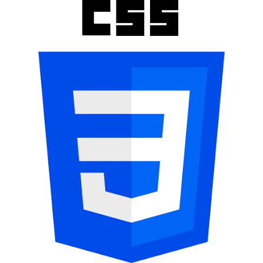

  

<h1 align="center">Hello i'm <a href="https://github.com/dothanhbinh102007-ux">dothanhbinh</a>!

  

</h1>

<h2 align="center">
	WELCOME:3333
	
I'm a backend developer and a game developer

</h2>
	<h1>
<strong>🔥About Me</strong>
</h1>
	
<strong>Game Developer</strong>: using  to make game 

	
<strong>Backend Developer:</strong>: using  to dev

	
<strong>Bonus:</strong> currently learning ,  and 

	
	

  <strong><a href="https://www.facebook.com/binh.do.535780">Facebook</a></strong> |
  <strong><a href="https://discord.gg/2rezesp3">Discord</a></strong> |

	

